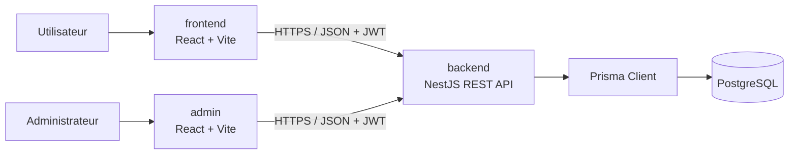
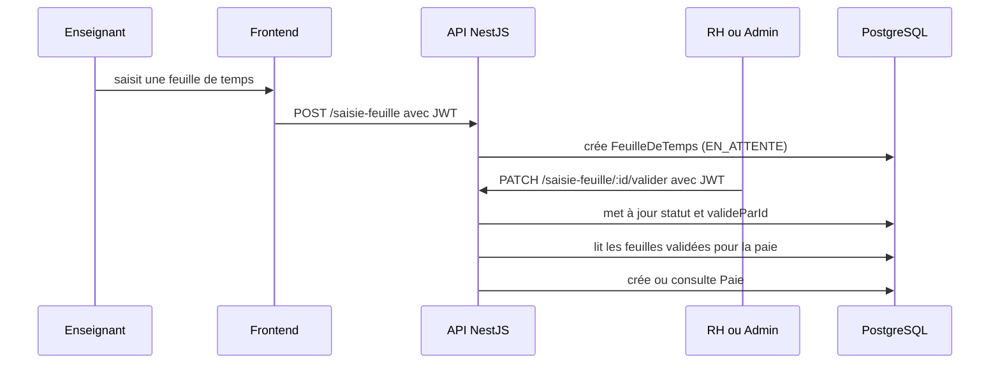

# Architecture technique

## Vue d'ensemble

ERP Honey regroupe la gestion des enseignants, des feuilles de temps, de la paie et des opérations financières par pôle. Le dépôt sépare l'expérience métier (`frontend`), l'administration (`admin`), l'API (`backend`) et PostgreSQL.

Le frontend conserve le jeton sous la clé `access_token` du navigateur. L'interface admin utilise `admin_token`. Chaque client Axios ajoute ce jeton au champ `Authorization: Bearer …` lorsqu'il existe.

## Répertoires

| Répertoire | Responsabilité |
| --- | --- |
| `backend/src/modules` | contrôleurs, services, DTO et modules NestJS par domaine |
| `backend/prisma` | schéma Prisma et historique des migrations PostgreSQL |
| `backend/src/generated/prisma` | client Prisma généré, à régénérer depuis le schéma |
| `frontend/src` | portail métier React, Redux Toolkit, pages et composants |
| `admin/src` | interface React dédiée à l'administration des utilisateurs |
| `docker-compose.yml` | environnement local de développement |
| `docs` | documentation d'architecture, base et exploitation |

## Backend

L'API NestJS initialise une validation globale : les champs non prévus dans les DTO sont rejetés et les valeurs peuvent être converties selon les types. Prisma fournit l'accès à PostgreSQL par l'adaptateur `@prisma/adapter-pg`.

| Module | Responsabilité observable |
| --- | --- |
| `user` | inscription, connexion, changement de mot de passe et utilisateurs |
| `teachers` | profil enseignant et liste d'enseignants |
| `saisie_feuille` | création, validation et consultation de feuilles de temps |
| `paie` | génération, liste et mise à jour du statut de paie |
| `pole`, `charge`, `revenu` | référentiel des pôles et mouvements financiers |
| `finance`, `bilan` | calculs et bilan financier par pôle |

Les routes protégées utilisent la stratégie JWT. Le code de contrôle d'accès vérifie le rôle dans les services et contrôleurs concernés ; les rôles stockés sont `ADMIN`, `RH`, `FINANCE` et `ENSEIGNANT`.

## Principaux flux métier

Les flux financiers rattachent chaque `Charge` et chaque `Revenu` à un `Pole`. Le bilan interroge ensuite les opérations du pôle demandé.

## Interfaces et routage

Le portail principal propose des tableaux de bord, la saisie des heures, la paie, les pôles et les écrans financiers selon le rôle. Il lit `VITE_API_URL`, avec `http://localhost:3001` comme valeur par défaut.

L'interface `admin` propose une connexion, un tableau de bord et la gestion des utilisateurs. À ce jour, son URL API est figée dans `admin/src/const/url.ts` sur `http://localhost:3001`. Cette différence empêche une configuration de production correcte par variable d'environnement seule.

## Frontières et points d'attention

- Les clients web exécutent le code dans le navigateur. Une URL d'API doit donc être publique et HTTPS.
- Le `docker-compose.yml` actuel apporte le confort de développement, avec rechargement à chaud et montages de sources. Il ne sépare pas les responsabilités de production.
- L'API active CORS pour toutes les origines et publie Swagger sur `/api`. Le reverse proxy ne remplace pas les contrôles applicatifs à prévoir avant exposition Internet.
- La base utilise des contraintes de clé étrangère pour les relations. Le schéma actuel ne définit pas d'index métier sur les dates, statuts ou clés de rattachement au-delà des clés et unicités décrites dans le document de base de données.

Consultez [le guide de production](PRODUCTION_DEPLOIEMENT.md) pour l'exploitation et [le modèle relationnel](BASE_DE_DONNEES.md) pour les tables et les contraintes.
