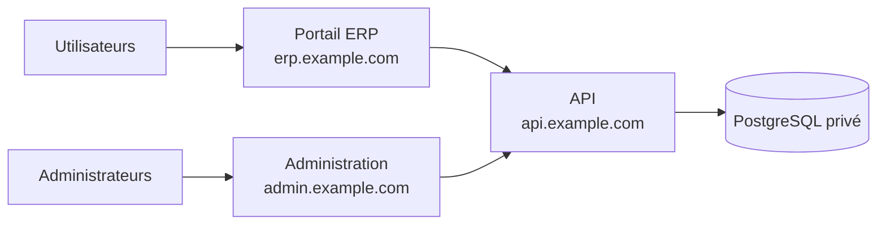

# Déploiement séparé des trois services

Ce document organise les trois services applicatifs en déploiements indépendants : API backend, portail ERP frontend et administration. PostgreSQL reste une dépendance privée de l'API ; il ne constitue pas un quatrième service web.

## Topologie



Chaque service peut vivre sur son propre serveur, dans son propre projet d'hébergement ou dans sa propre chaîne CI/CD. Les trois services partagent un contrat HTTP et une version de base de données, mais aucun partage de répertoire, de processus ou de secret n'est requis entre les deux interfaces et l'API.

## Responsabilités par service

| Service | Artefact à publier | Configuration de déploiement | Dépendances externes |
| --- | --- | --- | --- |
| `backend` | `dist/` NestJS et dépendances Node | `DATABASE_URL`, `JWT_SECRET`, `PORT` | PostgreSQL, proxy inverse |
| `frontend` | contenu de `dist/` Vite | `VITE_API_URL` injectée au build | URL HTTPS de l'API, hébergeur statique |
| `admin` | contenu de `dist/` Vite | `VITE_API_URL` prévue, mais non lue aujourd'hui | URL HTTPS de l'API, hébergeur statique |

Ne copiez pas `DATABASE_URL` ni `JWT_SECRET` dans les environnements frontend ou admin. Ces secrets appartiennent uniquement à l'API.

## Contrat entre les services

Les clients appellent l'API JSON avec un jeton Bearer. Le contrat visible dans le code comprend notamment les groupes de routes suivants :

| Domaine | Préfixe de route |
| --- | --- |
| Utilisateurs et authentification | `/user` |
| Enseignants | `/teachers` |
| Feuilles de temps | `/saisie-feuille` |
| Paies | `/paie` |
| Pôles, charges et revenus | `/pole`, `/charge`, `/revenu` |
| Bilan | `/bilan` |

Avant de publier une nouvelle interface, vérifiez qu'elle reste compatible avec la version de l'API en production. Conservez Swagger sur une surface d'accès restreinte : l'API actuelle le publie sous `/api`.

## Déploiement du backend seul

Le pipeline backend doit :

1. installer les dépendances avec `npm ci` ;
2. générer le client Prisma avec `npx prisma generate` ;
3. exécuter les tests et `npm run build` ;
4. produire un artefact ou une release identifiée par le SHA Git ;
5. sauvegarder PostgreSQL puis lancer `npx prisma migrate deploy` une fois ;
6. redémarrer le processus API et observer ses logs.

L'API requiert une base disponible avant son démarrage. Un déploiement backend peut contenir une migration ; coordonnez-le avec les équipes frontend et admin lorsque la réponse JSON, les règles d'authentification ou la structure de données changent.

## Déploiement du frontend seul

Le pipeline frontend n'a pas besoin d'accès à PostgreSQL. Il nécessite l'URL publique de l'API pendant la compilation :

```bash
cd frontend
npm ci
VITE_API_URL=https://api.example.com npm run build
```

Publiez le contenu de `frontend/dist/` sur un hébergeur statique, un CDN ou Nginx. Configurez la réécriture des routes inconnues vers `index.html`, car React Router gère les chemins dans le navigateur. Invalidez le cache CDN des fichiers HTML après chaque déploiement ; les fichiers Vite dont le nom contient un hash peuvent rester cacheables longtemps.

Validez après publication : ouverture de la page de connexion, appel réseau vers la bonne URL API, connexion avec un compte de test et navigation directe vers une route protégée.

## Déploiement de l'administration seule

Le pipeline de build est le même :

```bash
cd admin
npm ci
VITE_API_URL=https://api.example.com npm run build
```

La séparation d'hébergement reste possible, mais le build actuel ne lit pas `VITE_API_URL`. `admin/src/const/url.ts` fixe l'API à `http://localhost:3001`, qui désigne la machine de chaque visiteur et non le serveur de production. Considérez le déploiement externe de l'administration comme bloqué jusqu'à une modification de code explicitement planifiée et testée.

Quand ce point sera corrigé, publiez `admin/dist/` sous `admin.example.com`, configurez le même repli SPA que pour le frontend et appliquez un contrôle d'accès supplémentaire au niveau du proxy ou du fournisseur d'identité.

## Ordonnancement et compatibilité

| Changement | Ordre de publication conseillé |
| --- | --- |
| Modification visuelle sans nouvel appel API | frontend ou admin seul |
| Nouvel endpoint API facultatif | API, puis interface qui l'utilise |
| Champ de réponse ajouté | API, puis interfaces |
| Champ ou endpoint supprimé | interfaces compatibles, puis API après la période de transition |
| Migration de base de données | migration compatible, API, interfaces, nettoyage dans une release ultérieure |

Évitez les migrations qui suppriment ou renomment immédiatement une colonne consommée par l'API existante. Une phase de compatibilité permet de publier les services à des moments différents sans interruption.

## Réseaux, domaines et CORS

Utilisez des domaines distincts et HTTPS pour les services publics :

| Service | Domaine exemple | Accès |
| --- | --- | --- |
| Frontend | `https://erp.example.com` | public selon les règles métier |
| Admin | `https://admin.example.com` | administrateurs autorisés |
| API | `https://api.example.com` | uniquement via HTTPS |
| PostgreSQL | aucun domaine public | API seulement |

L'API active aujourd'hui CORS pour toute origine. Avant l'ouverture publique, une évolution backend doit remplacer ce réglage par la liste exacte des domaines frontend et admin. La séparation d'hébergement rend cette correction nécessaire, car elle fixe les appels cross-origin.

## Retour arrière indépendant

- Pour le frontend ou l'admin, réactivez le répertoire statique ou la version CDN précédente. Aucun retour PostgreSQL ne doit être nécessaire.
- Pour l'API, réactivez l'artefact précédent si son contrat reste compatible avec la migration déjà appliquée.
- Pour une migration irréversible, restaurez une sauvegarde testée dans le cadre de la procédure d'incident. Ne lancez pas de commande Prisma destructive pour tenter un retour rapide.

## Liste de validation par release

- [ ] Le SHA, la date et le propriétaire de la release sont enregistrés.
- [ ] L'artefact ne contient aucun fichier `.env` ni secret.
- [ ] Le frontend cible la bonne URL `https://api.example.com` dans les requêtes réseau.
- [ ] Les migrations ont été exécutées une seule fois et une sauvegarde récente est disponible.
- [ ] Le compte de test valide le parcours correspondant au service publié.
- [ ] La supervision vérifie la disponibilité de l'API et l'accessibilité des deux sites.

Pour un déploiement sur serveur sans conteneur, appliquez [DEPLOIEMENT_SANS_DOCKER.md](DEPLOIEMENT_SANS_DOCKER.md). Pour les mesures transverses de sauvegarde, TLS et sécurité, appliquez [PRODUCTION_DEPLOIEMENT.md](PRODUCTION_DEPLOIEMENT.md).
